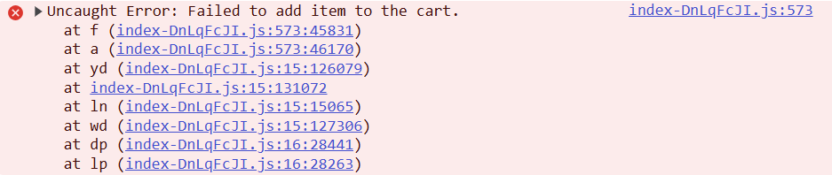

# Prendas que no se agregan ingresando con el usuario "error_user"

**Severidad:** Alta | **Prioridad:** Media

## Pasos

1. Ingresar con el usuario `error_user` y contraseña `secret_sauce`
2. Agregar las prendas al carrito dando clic en el botón "Add to cart" de cada una
3. Intentar agregar Sauce Labs Bolt T-Shirt, Sauce Labs Fleece Jacket y Test.allTheThings() T-Shirt (Red)

## Esperado

Todas las prendas se agregan al carrito.

## Obtenido

Las prendas Sauce Labs Bolt T-Shirt, Sauce Labs Fleece Jacket y Test.allTheThings() T-Shirt (Red) no se agregan.

En Console: "Uncaught Error: Failed to add item to the cart"

## Evidencia

## Entorno

Brave, 1.99.55, Windows
