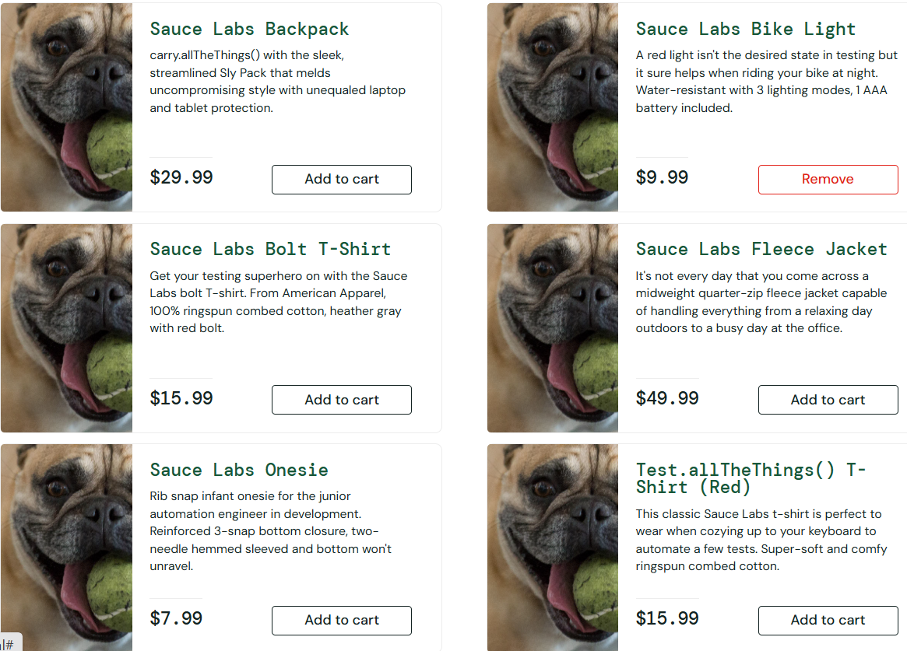

# Imágenes de perro al ingresar con el usuario "problem_user"

**Severidad:** Media | **Prioridad:** Baja

## Pasos

1. Ingresar con el usuario `problem_user` y contraseña `secret_sauce`
2. Observar las imágenes de los productos en la página principal

## Esperado

Cada producto muestra su propia imagen.

## Obtenido

Todos los productos muestran la imagen de un perro.

## Evidencia

## Entorno

Brave, 1.99.55, Windows
